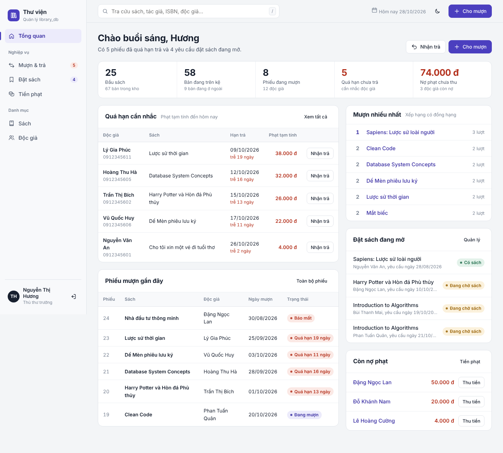
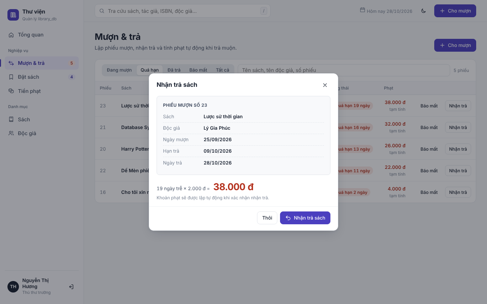
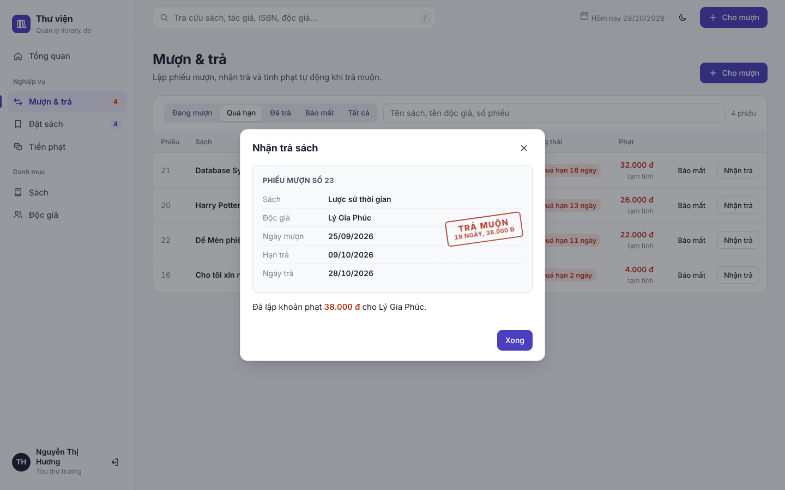
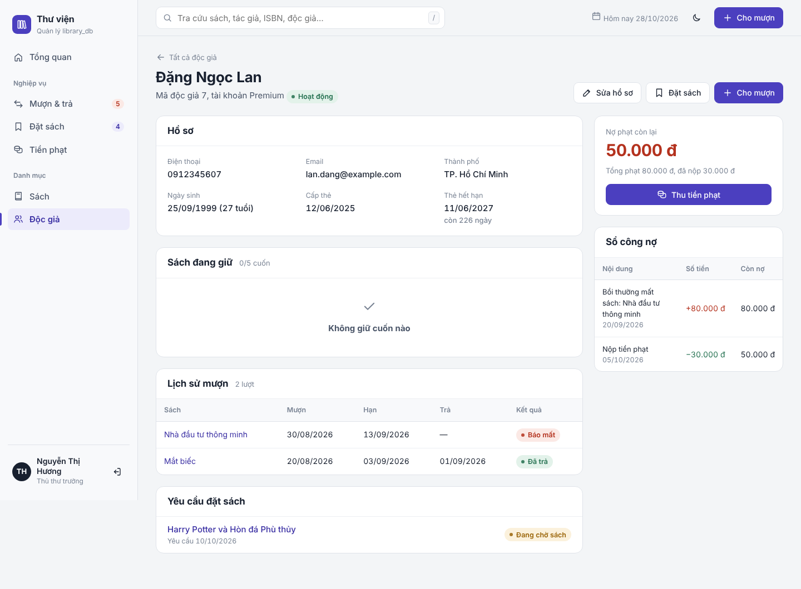
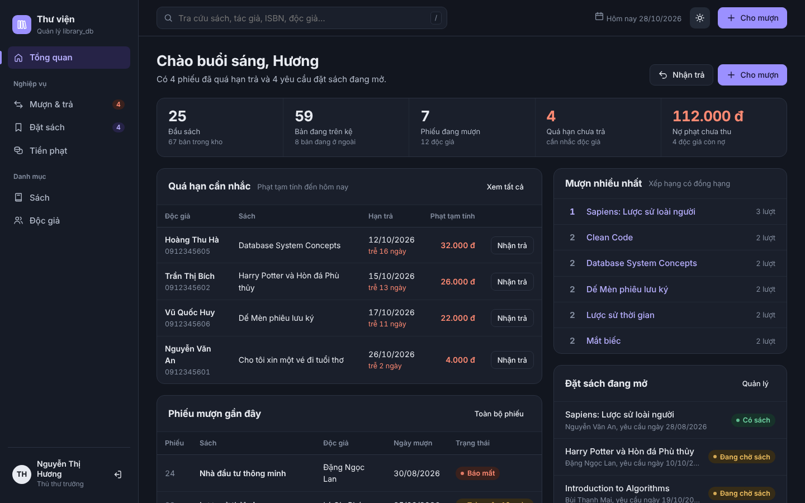
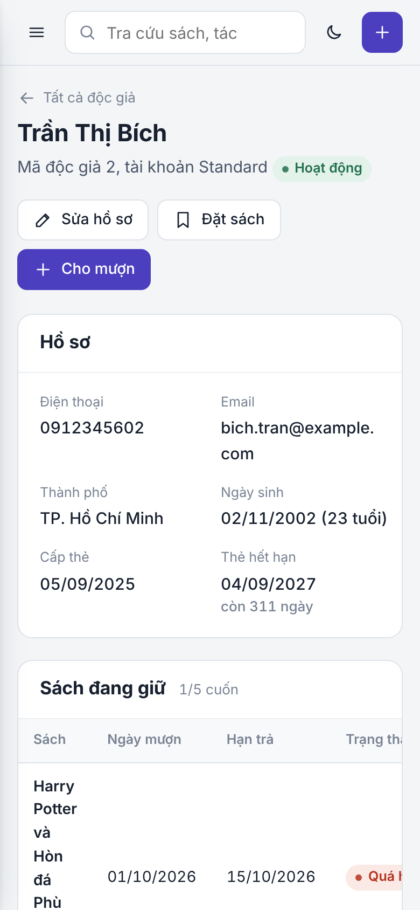

# Thư viện — giao diện quản lý cho `library_db`

Ứng dụng web chạy trên `localhost` dành cho **thủ thư**, dựng trực tiếp trên cơ sở dữ liệu `library_db` (MySQL 8) của bài tập lớn môn Cơ sở dữ liệu. Giao diện không tự viết lại nghiệp vụ: nó **gọi đúng các bảng, trigger, stored procedure và view** đã thiết kế trong báo cáo, nên mọi quy tắc (tối đa 5 cuốn, hạn 14 ngày, phạt 2.000 đ/ngày, trừ – cộng kho tự động) vẫn do database quyết định.



---

## Mục lục

1. [Tính năng](#1-tính-năng)
2. [Công nghệ và lý do chọn](#2-công-nghệ-và-lý-do-chọn)
3. [Cấu trúc thư mục](#3-cấu-trúc-thư-mục)
4. [Cài đặt và chạy trên localhost](#4-cài-đặt-và-chạy-trên-localhost)
5. [Giao diện kết nối với database như thế nào](#5-giao-diện-kết-nối-với-database-như-thế-nào)
6. [Quy tắc nghiệp vụ nằm ở đâu](#6-quy-tắc-nghiệp-vụ-nằm-ở-đâu)
7. [Danh sách API](#7-danh-sách-api)
8. [Bảo mật](#8-bảo-mật)
9. [Xử lý lỗi thường gặp](#9-xử-lý-lỗi-thường-gặp)
10. [Đưa lên GitHub](#10-đưa-lên-github)
11. [Giới hạn và hướng mở rộng](#11-giới-hạn-và-hướng-mở-rộng)

---

## 1. Tính năng

Bố cục gồm một **thanh bên** chia theo nghiệp vụ và một **thanh trên** có ô tra cứu nhanh, ngày hôm nay, nút đổi sáng/tối và nút **Cho mượn** dùng được từ mọi màn hình.

```
┌──────────────┬───────────────────────────────────────────────────────┐
│ Thư viện     │ [ Tra cứu sách, tác giả, ISBN, độc giả…  / ]  ☾  [+]  │
│              ├───────────────────────────────────────────────────────┤
│ Tổng quan    │  Tiêu đề trang                       [Hành động]      │
│ Nghiệp vụ    │                                                       │
│  Mượn & trả 5│  ┌ Bộ lọc ──────────────────────────────────────────┐ │
│  Đặt sách   4│  │ Bảng dữ liệu / hồ sơ / biểu mẫu                  │ │
│  Tiền phạt   │  └──────────────────────────────────────────────────┘ │
│ Danh mục     │                                                       │
│  Sách        │                                                       │
│  Độc giả     │                                                       │
│ ──────────── │                                                       │
│ NT Hương  ⇥  │                                                       │
└──────────────┴───────────────────────────────────────────────────────┘
```

Số đỏ cạnh "Mượn & trả" là phiếu quá hạn; số tím cạnh "Đặt sách" là yêu cầu đang mở.

| Yêu cầu | Màn hình | Làm được gì |
| --- | --- | --- |
| **Đăng nhập** | Trang đăng nhập | Thủ thư đăng nhập bằng tài khoản riêng (mật khẩu băm bcrypt). Thủ thư trưởng có thêm quyền sửa danh mục sách. Phiên tự hết sau 8 giờ (một ca làm). |
| **Tra cứu** | Ô tìm ở thanh trên (phím `/`) | Gõ một lần, ra cả sách (theo tên, ISBN, tác giả, mã) và độc giả (theo tên, SĐT, email, mã). Dùng phím ↑ ↓ Enter để chọn. |
| **Thông tin sách** | Sách, Chi tiết sách | Lọc theo thể loại, nhà xuất bản, còn bản; sắp theo tên, năm, độ phổ biến. Chi tiết gồm ISBN, vị trí tầng/kệ, số bản còn, ai đang giữ, lịch sử mượn, hàng chờ đặt trước. Thủ thư trưởng thêm, sửa, xóa sách và tác giả. |
| **Theo dõi thành viên** | Độc giả, Hồ sơ độc giả | Lọc theo trạng thái tài khoản, còn nợ phạt, đang giữ sách quá hạn. Hồ sơ hiện thời hạn thẻ (còn bao nhiêu ngày), sách đang giữ x/5, lịch sử mượn, yêu cầu đặt sách và **sổ công nợ** có số dư lũy kế. |
| **Mượn & trả** | Mượn & trả | Lập phiếu mượn có kiểm tra trước (tài khoản, thẻ, 5 cuốn, còn bản, nợ phạt). Nhận trả hiện **phiếu hạn trả**; khi xác nhận, con dấu "Đã trả" hoặc "Trả muộn" được đóng lên phiếu. Báo mất sách kèm tiền bồi thường. |
| **Tính tiền phạt** | Tiền phạt, hộp thoại Nhận trả | Máy tính tiền phạt (chọn phiếu hoặc nhập ngày), danh sách độc giả còn nợ, các khoản phạt, các lần nộp. Thu tiền không cho nộp quá số còn nợ. |
| **Đặt sách** | Đặt sách | Tạo yêu cầu: còn bản thì chuyển ngay sang "Có sách", hết bản thì vào hàng chờ với ngày dự kiến. Xem thứ tự trong hàng chờ, báo có sách, giao sách (tự lập phiếu mượn), hủy. Khi một cuốn được trả, người chờ lâu nhất tự được chuyển sang "Có sách". |

| Nhận trả: trước khi xác nhận | Sau khi xác nhận |
| --- | --- |
|  |  |

| Hồ sơ độc giả | Giao diện tối | Điện thoại |
| --- | --- | --- |
|  |  |  |

Các ảnh còn lại nằm trong [`docs/screenshots/`](docs/screenshots).

**Về thiết kế.** Nền giấy lạnh, chữ màu mực; màu nhấn là **tím mực dấu** của con dấu thư viện. Màu đỏ chỉ dùng cho trễ hạn và nợ phạt, xanh cho đúng hạn và còn sách, nên chỉ cần lướt mắt là thấy chỗ cần xử lý. Một phông chữ duy nhất (Be Vietnam Pro) hiển thị dấu tiếng Việt chuẩn; số trong bảng dùng chữ số đều cột. Chuyển động chỉ có ở chỗ đáp lại thao tác của người dùng: chuyển trang mờ dần, hộp thoại mở ra, và con dấu đóng xuống phiếu khi nhận trả. Hệ thống tôn trọng cài đặt "giảm chuyển động" của máy.

---

## 2. Công nghệ và lý do chọn

| Lớp | Công nghệ | Vì sao |
| --- | --- | --- |
| Database | MySQL 8.0.16+ | Giữ nguyên thiết kế của báo cáo. Bản 8.0.16 trở lên mới thực thi ràng buộc `CHECK`. |
| Máy chủ | Node.js 18+ với Express 5 | Ít mã, dễ đọc. Express 5 tự chuyển lỗi của hàm `async` đến bộ xử lý lỗi chung. |
| Kết nối DB | `mysql2/promise` (connection pool) | Hỗ trợ `CALL` procedure, transaction, câu lệnh có tham số `?` (chống SQL injection). |
| Đăng nhập | `express-session` + `bcryptjs` | Phiên lưu ở máy chủ, cookie `httpOnly`; mật khẩu chỉ lưu dạng băm. |
| Giao diện | HTML + CSS + JavaScript thuần (ES modules) | **Không cần bước build**, không cần cài thêm công cụ: `npm start` là chạy. Dễ đọc để giải thích trong báo cáo. |

Tổng cộng chỉ 5 thư viện npm: `express`, `mysql2`, `express-session`, `bcryptjs`, `dotenv`.

---

## 3. Cấu trúc thư mục

```
library-db-ui/
├── database/                  # Chạy theo đúng thứ tự số
│   ├── 01_db_creation.sql     # 14 bảng (file db_creation.sql của nhóm)
│   ├── 02_routines.sql        # 3 trigger, 2 procedure, 3 view (routines.sql)
│   ├── 03_data.sql            # Dữ liệu mẫu (data.sql)
│   └── 04_app_auth.sql        # Bảng staff_account cho đăng nhập (phần mở rộng)
├── scripts/
│   ├── setup-db.js            # npm run db:setup  – chạy cả 4 file SQL
│   ├── check-db.js            # npm run db:check  – kiểm tra đủ bảng/view/trigger
│   └── sql-runner.js          # Hiểu lệnh DELIMITER khi chạy file .sql từ Node
├── src/                       # Máy chủ (REST API)
│   ├── server.js              # Khởi động Express, gắn route, phục vụ public/
│   ├── config.js              # Đọc .env + các hằng số nghiệp vụ để hiển thị
│   ├── db.js                  # Connection pool + hàm withTransaction()
│   ├── queries.js             # Các đoạn SELECT dùng lại (phiếu mượn, độc giả, đặt sách)
│   ├── util.js                # Kiểm tra dữ liệu đầu vào
│   ├── middleware/
│   │   ├── auth.js            # requireAuth, requireAdmin
│   │   └── errors.js          # Đổi lỗi MySQL/SIGNAL sang thông báo tiếng Việt
│   └── routes/                # Mỗi file một nhóm nghiệp vụ
│       ├── auth.js  dashboard.js  search.js  lookups.js
│       ├── books.js  members.js
│       └── loans.js  requests.js  fines.js
├── public/                    # Giao diện (file tĩnh)
│   ├── index.html
│   ├── css/app.css            # Toàn bộ giao diện, có biến màu cho sáng/tối
│   └── js/
│       ├── main.js            # Khung trang, định tuyến #/..., ô tra cứu nhanh
│       ├── api.js             # Hàm gọi API
│       ├── ui.js              # Tạo HTML an toàn, định dạng, hộp thoại, ô chọn
│       ├── state.js           # Người dùng, danh mục, làm mới sau thay đổi
│       ├── dialogs.js         # Cho mượn, nhận trả, báo mất, thu tiền, đặt sách, biểu mẫu
│       └── views/             # Mỗi màn hình một file
├── docs/screenshots/
├── .env.example
├── package.json
└── README.md
```

---

## 4. Cài đặt và chạy trên localhost

### Bước 0. Chuẩn bị

- **Node.js 18 trở lên**: kiểm tra bằng `node -v`. Tải tại nodejs.org (bản LTS).
- **MySQL Server 8.0.16 trở lên** đang chạy, cùng tài khoản và mật khẩu bạn vẫn dùng trong MySQL Workbench.

### Bước 1. Lấy mã nguồn và cài thư viện

```bash
git clone https://github.com/<tài-khoản>/library-db-ui.git
cd library-db-ui
npm install
```

### Bước 2. Khai báo kết nối database

Sao chép file mẫu thành `.env`:

```bash
cp .env.example .env        # macOS / Linux
copy .env.example .env      # Windows (cmd)
```

Mở `.env` và điền đúng thông số, **giống hệt ô kết nối trong MySQL Workbench** (Hostname, Port, Username, Password):

```ini
PORT=3000
DB_HOST=127.0.0.1
DB_PORT=3306
DB_USER=root
DB_PASSWORD=mat_khau_mysql_cua_ban
DB_NAME=library_db
SESSION_SECRET=mot-chuoi-dai-ngau-nhien-bat-ky
```

> Nên dùng `127.0.0.1` thay vì `localhost`: trên một số máy, `localhost` được hiểu thành IPv6 `::1` trong khi MySQL chỉ nghe IPv4.

### Bước 3. Tạo database

Chọn **một** trong hai cách.

**Cách A – một lệnh (khuyên dùng):**

```bash
npm run db:setup
```

Lệnh này chạy lần lượt `01 → 02 → 03 → 04` trong thư mục `database/`. Kết quả mong đợi:

```
Đã kết nối MySQL tại 127.0.0.1:3306
  chạy 01_db_creation.sql ... xong
  chạy 02_routines.sql ... xong
  chạy 03_data.sql ... xong
  chạy 04_app_auth.sql ... xong
Hoàn tất: 25 đầu sách, 12 độc giả.
```

> ⚠ Lệnh này **xóa và tạo lại** toàn bộ `library_db`. Chạy lại bất cứ lúc nào để đưa dữ liệu về trạng thái mẫu ban đầu.

**Cách B – bằng MySQL Workbench:** mở và chạy (biểu tượng tia sét) lần lượt bốn file `01_db_creation.sql`, `02_routines.sql`, `03_data.sql`, `04_app_auth.sql`. Workbench hiểu lệnh `DELIMITER` nên file 02 chạy được nguyên văn. Nếu chạy lại file 01 khi đã có bảng `staff_account`, hãy chạy `DROP TABLE IF EXISTS library_db.staff_account;` trước (bảng này trỏ khóa ngoại tới `library_staff`).

Kiểm tra lại:

```bash
npm run db:check
```

```
✓ Bảng: 15/15
✓ View: 3/3
✓ Procedure: 2/2
✓ Trigger: 3/3
Database sẵn sàng. Chạy "npm start".
```

### Bước 4. Chạy ứng dụng

```bash
npm start          # hoặc: npm run dev  (tự khởi động lại khi sửa mã)
```

Mở trình duyệt tại **http://localhost:3000** và đăng nhập:

| Tên đăng nhập | Mật khẩu | Nhân viên | Quyền |
| --- | --- | --- | --- |
| `huong` | `admin123` | Nguyễn Thị Hương, Thủ thư trưởng | Tất cả, kể cả thêm/sửa/xóa sách |
| `khoa` | `thuthu123` | Trần Văn Khoa, Thủ thư | Nghiệp vụ hằng ngày |
| `lan` | `thuthu123` | Lê Thị Lan, Thủ thư | Nghiệp vụ hằng ngày |

> Dữ liệu mẫu được dựng quanh mốc ngày 23/10/2026. Trạng thái "quá hạn" và tiền phạt tạm tính được tính theo **ngày hiện tại của máy chủ MySQL** (`CURDATE()`), nên số liệu bạn thấy sẽ thay đổi theo ngày chạy.

### Thử nhanh các kịch bản có sẵn trong dữ liệu mẫu

| Thử gì | Cách làm | Kết quả mong đợi |
| --- | --- | --- |
| Trả muộn có phạt | Mượn & trả → Quá hạn → Nhận trả phiếu bất kỳ | Phiếu được đóng dấu "Trả muộn", khoản phạt = số ngày trễ × 2.000 đ |
| Trả sách có người chờ | Nhận trả phiếu 20 (Harry Potter) | Thông báo Đặng Ngọc Lan đang chờ; yêu cầu của chị chuyển sang "Có sách" |
| Tài khoản bị khóa | Cho mượn → chọn Đỗ Khánh Nam | Hiện lý do "Tài khoản đang ở trạng thái suspended", nút Cho mượn bị khóa |
| Thẻ hết hạn | Cho mượn → chọn Ngô Phương Oanh | "Thẻ thư viện đã hết hạn" |
| Hết bản sao | Cho mượn → sách Introduction to Algorithms | "Sách đã hết bản để cho mượn"; dùng Đặt trước thay thế |
| Giới hạn 5 cuốn | Cho mượn liên tục cho một độc giả | Cuốn thứ 6 bị trigger chặn |
| Thu tiền phạt | Tiền phạt → Thu tiền cho Đặng Ngọc Lan | Không thu được quá 50.000 đ; sổ công nợ cập nhật |
| Quyền | Đăng nhập `khoa` | Không có nút Thêm/Sửa/Xóa sách |

---

## 5. Giao diện kết nối với database như thế nào

### Ba tầng

```
 Trình duyệt                    Máy chủ Node.js                     MySQL 8
 (public/)                      (src/)                              (library_db)
┌──────────────┐  fetch JSON  ┌─────────────────────────┐  SQL    ┌──────────────────────┐
│ views/*.js   │ ───────────▶ │ routes/*.js             │ ──────▶ │ 14 bảng              │
│ dialogs.js   │              │  • kiểm tra đầu vào     │         │ 3 trigger            │
│              │ ◀─────────── │  • gọi SELECT/CALL      │ ◀────── │ 2 stored procedure   │
│ (không biết  │  JSON / lỗi  │  • đổi lỗi → tiếng Việt │ kết quả │ 3 view               │
│  SQL)        │              │ db.js: pool 10 kết nối  │         │ + staff_account      │
└──────────────┘              └─────────────────────────┘         └──────────────────────┘
```

Trình duyệt **không bao giờ** kết nối trực tiếp tới MySQL. Mọi truy vấn đi qua máy chủ, nơi mật khẩu database được giữ trong `.env`.

### Kết nối được tạo ở đâu

`src/db.js` tạo một **connection pool** (một nhóm 10 kết nối dùng lại):

```js
const pool = mysql.createPool({
  host, port, user, password, database,   // lấy từ .env
  charset: 'utf8mb4',     // tiếng Việt có dấu
  dateStrings: true,      // DATE trả về '2026-10-28', không bị lệch múi giờ
  decimalNumbers: true,   // SUM(...) trả về số, không phải chuỗi
});
```

Vì sao dùng pool: mở một kết nối MySQL mất thời gian; pool giữ sẵn vài kết nối và cho mượn lại, giống cách thư viện cho mượn sách.

### Ví dụ đi trọn một thao tác: Nhận trả sách

1. Thủ thư bấm **Nhận trả sách** → `dialogs.js` gửi `POST /api/loans/20/return`.
2. `routes/loans.js` kiểm tra phiếu chưa bị báo mất, rồi gọi procedure của nhóm:
   ```js
   const [result] = await pool.query('CALL sp_return_book(?)', [id]);
   ```
3. Bên trong MySQL, `sp_return_book` mở transaction, khóa dòng phiếu (`FOR UPDATE`), ghi `return_date = CURDATE()`:
   - trigger `trg_issue_before_update` đổi `issue_status` thành `returned`;
   - trigger `trg_issue_after_update` cộng lại 1 vào `book.copies_available`;
   - procedure thấy trễ hạn thì `INSERT` vào `fine_due` với `số ngày × 2.000`.
4. Máy chủ tìm yêu cầu `pending` lâu nhất của cuốn này trong `book_request` và chuyển sang `available`.
5. Kết quả `{ days_late, fine_amount, notified }` về lại trình duyệt; giao diện đóng dấu lên phiếu và làm mới số liệu.

Nếu procedure báo lỗi bằng `SIGNAL SQLSTATE '45000'`, `middleware/errors.js` đổi thông báo không dấu (ví dụ `Sach da het ban sao co san`) thành câu tiếng Việt có dấu cho người dùng.

### Màn hình nào dùng đối tượng SQL nào

| Màn hình | Bảng / view / routine được dùng |
| --- | --- |
| Tổng quan | `v_overdue_books`, `v_member_fine_balance`, truy vấn `RANK() OVER` (truy vấn 7 của báo cáo) |
| Sách | `v_book_catalog` (đã gộp tác giả bằng `GROUP_CONCAT`), `book`, `location`, `book_author` |
| Cho mượn | `CALL sp_issue_book` → trigger `trg_issue_before_insert` |
| Nhận trả | `CALL sp_return_book` → `trg_issue_before_update`, `trg_issue_after_update`, `fine_due` |
| Báo mất | Transaction: `UPDATE book_issue` + `INSERT fine_due` |
| Đặt sách, giao sách | `book_request`, `book_request_status`; giao sách = transaction gồm `CALL sp_issue_book` + `UPDATE book_request` |
| Độc giả, sổ công nợ | `members`, `member_status`, `v_member_fine_balance`, `fine_due`, `fine_payment` |
| Tiền phạt | `fine_due ⋈ book_issue ⋈ members` (truy vấn 6 của báo cáo), `fine_payment` |
| Đăng nhập | `staff_account ⋈ library_staff` |

### Vì sao cần bảng `staff_account`

14 bảng của báo cáo không có chỗ lưu mật khẩu. `04_app_auth.sql` thêm bảng `staff_account` quan hệ **1–1** với `library_staff` (khóa chính đồng thời là khóa ngoại), gồm `username` duy nhất, `password_hash` (bcrypt) và `role`. Bảng này tách riêng để 14 bảng trong báo cáo giữ nguyên.

Tạo thêm tài khoản cho nhân viên mới:

```bash
node -e "console.log(require('bcryptjs').hashSync('mat-khau-moi', 10))"
```

```sql
INSERT INTO library_staff (staff_name, staff_designation) VALUES ('Tên nhân viên', 'Thủ thư');
INSERT INTO staff_account (staff_id, username, password_hash, role)
VALUES (LAST_INSERT_ID(), 'tendangnhap', '<chuỗi băm vừa in ra>', 'librarian');
```

---

## 6. Quy tắc nghiệp vụ nằm ở đâu

Nguyên tắc: **database là nơi quyết định cuối cùng**; máy chủ chỉ kiểm tra thêm những gì database chưa có, và kiểm tra sớm để báo lỗi dễ hiểu hơn.

| Quy tắc | Nơi thực thi |
| --- | --- |
| Tài khoản phải `active` mới được mượn | Trigger `trg_issue_before_insert` |
| Tối đa 5 cuốn chưa trả | Trigger `trg_issue_before_insert` |
| Còn bản mới cho mượn; trừ kho an toàn khi mượn đồng thời | Trigger (`UPDATE … WHERE copies_available > 0` + `ROW_COUNT()`) |
| Hạn mượn mặc định 14 ngày | Procedure `sp_issue_book` |
| Phạt 2.000 đ/ngày trễ, tự lập khi trả | Procedure `sp_return_book` |
| Cộng lại kho đúng một lần khi trả | Trigger `trg_issue_after_update` |
| `copies_available` trong khoảng 0…`copies_total`; ngày hợp lệ; tiền > 0 | Ràng buộc `CHECK` |
| ISBN, email không trùng; mỗi phiếu tối đa một khoản phạt | Ràng buộc `UNIQUE` |
| Thẻ hết hạn (`membership_end_date`) không được mượn | Máy chủ (`routes/loans.js`) – trigger chỉ xét `account_status` |
| Không thu quá số còn nợ | Máy chủ, trong transaction có khóa dòng độc giả |
| Không giảm `copies_total` dưới số bản đang cho mượn | Máy chủ, trong transaction `SELECT … FOR UPDATE` |
| Người chờ lâu nhất được báo khi sách về | Máy chủ, sau `sp_return_book` |
| Trạng thái "quá hạn" | Tính lúc truy vấn: `due_date < CURDATE()` (không lưu, nên luôn đúng theo ngày hiện tại) |

Các hằng số 14 / 5 / 2.000 cũng được nhắc lại trong `src/config.js` để giao diện hiển thị và tính thử. Nếu đổi quy tắc trong `02_routines.sql`, hãy đổi cả ở đó.

---

## 7. Danh sách API

Mọi API trả JSON. Trừ `/api/auth/*`, tất cả cần đăng nhập. Lỗi có dạng `{ "error": "thông báo tiếng Việt" }`.

| Phương thức | Đường dẫn | Mô tả |
| --- | --- | --- |
| POST | `/api/auth/login` | `{ username, password }` |
| POST | `/api/auth/logout` | Đăng xuất |
| GET | `/api/auth/me` | Nhân viên đang đăng nhập (hoặc `null`) |
| GET | `/api/lookups` | Thể loại, NXB, vị trí, tác giả, trạng thái, quy tắc, ngày hôm nay |
| POST | `/api/lookups/authors` | Thêm tác giả *(Thủ thư trưởng)* |
| GET | `/api/dashboard` | Số liệu tổng quan |
| GET | `/api/search?q=` | Tra cứu sách + độc giả |
| GET | `/api/books?q=&category_id=&publisher_id=&available=1&sort=` | Danh sách sách |
| GET | `/api/books/:id` | Chi tiết sách, phiếu, hàng chờ |
| POST / PUT / DELETE | `/api/books[/:id]` | Thêm / sửa / xóa *(Thủ thư trưởng)* |
| GET | `/api/members?q=&status=&type=&debt=1&overdue=1` | Danh sách độc giả |
| GET | `/api/members/:id` | Hồ sơ, phiếu, yêu cầu, sổ công nợ |
| POST / PUT | `/api/members[/:id]` | Thêm / sửa độc giả |
| GET | `/api/loans?state=open\|overdue\|returned\|lost\|all&q=` | Phiếu mượn |
| GET | `/api/loans/check?member_id=&book_id=` | Kiểm tra trước khi cho mượn (không ghi gì) |
| POST | `/api/loans` | `{ book_id, member_id, days }` → `CALL sp_issue_book` |
| POST | `/api/loans/:id/return` | `CALL sp_return_book` |
| POST | `/api/loans/:id/lost` | `{ amount }` báo mất + bồi thường |
| GET | `/api/requests?status=open\|pending\|available\|fulfilled\|cancelled\|all` | Yêu cầu đặt sách |
| POST | `/api/requests` | `{ book_id, member_id }` |
| PATCH | `/api/requests/:id` | `{ status: 'available' \| 'cancelled' }` |
| POST | `/api/requests/:id/fulfill` | Giao sách: lập phiếu + đóng yêu cầu |
| GET | `/api/fines` · `/api/fines/balances` · `/api/fines/payments` | Khoản phạt, công nợ, lần nộp |
| POST | `/api/fines/payments` | `{ member_id, amount, payment_date }` |

---

## 8. Bảo mật

- **SQL injection:** mọi giá trị từ người dùng đi qua tham số `?` của `mysql2`, không bao giờ nối chuỗi vào câu SQL. Ô tìm kiếm còn thoát ký tự `%` và `_` của `LIKE`.
- **XSS:** giao diện tạo HTML bằng hàm `html\`…\`` trong `ui.js`, tự thoát mọi giá trị chèn vào (tên sách, tên độc giả…).
- **Mật khẩu:** chỉ lưu băm bcrypt; sai quá 10 lần trong 15 phút thì tạm khóa theo IP; tạo phiên mới khi đăng nhập.
- **Cookie phiên:** `httpOnly`, `sameSite=lax`, hết hạn sau 8 giờ.
- **Phân quyền:** sửa danh mục sách chỉ dành cho `role = admin`, kiểm tra ở máy chủ (ẩn nút trên giao diện chỉ là phụ).
- **Bí mật:** `.env` nằm trong `.gitignore`. Không đưa mật khẩu MySQL lên GitHub.

Phiên đăng nhập lưu trong bộ nhớ máy chủ, đủ cho localhost. Nếu triển khai thật, cần kho phiên bền vững (ví dụ `express-mysql-session`), HTTPS, đổi mật khẩu mặc định và bỏ khung "Tài khoản mẫu" ở trang đăng nhập.

---

## 9. Xử lý lỗi thường gặp

| Hiện tượng | Nguyên nhân và cách sửa |
| --- | --- |
| `ECONNREFUSED 127.0.0.1:3306` | MySQL chưa chạy (Windows: Services → MySQL80 → Start), hoặc sai `DB_PORT`. |
| `Access denied for user 'root'@'localhost'` | Sai `DB_USER`/`DB_PASSWORD` trong `.env`. Thử đăng nhập bằng Workbench với đúng thông số đó. |
| `Unknown database 'library_db'` | Chưa tạo database: chạy `npm run db:setup`. |
| `Table 'library_db.staff_account' doesn't exist` | Đã chạy 01–03 bằng Workbench nhưng quên `04_app_auth.sql`. |
| `Cannot drop table 'library_staff' referenced by a foreign key` | Chạy lại 01 bằng tay khi đã có `staff_account`. Dùng `npm run db:setup`, hoặc xóa `staff_account` trước. |
| `Check constraint ... is violated` khi nạp dữ liệu | MySQL cũ hơn 8.0.16 thì `CHECK` bị bỏ qua, mới hơn thì thực thi; kiểm tra lại dữ liệu nhập. |
| Lỗi cú pháp gần `DELIMITER` | Công cụ bạn dùng không hiểu `DELIMITER`. Dùng `npm run db:setup` hoặc Workbench. |
| Tiếng Việt thành `?` hoặc ký tự lạ | Database phải dùng `utf8mb4` (file 01 đã đặt sẵn); khi nhập tay bằng client dòng lệnh, thêm `--default-character-set=utf8mb4`. |
| `EADDRINUSE :3000` | Cổng 3000 đang bận: đổi `PORT=3001` trong `.env`. |
| Đăng nhập xong lại bị đẩy ra | Máy chủ vừa khởi động lại (phiên nằm trong bộ nhớ). Đăng nhập lại. |
| Phông chữ khác ảnh chụp | Máy không có mạng nên không tải được Be Vietnam Pro từ Google Fonts; giao diện tự dùng phông hệ thống. |

---

## 10. Đưa lên GitHub

```bash
git init
git add .
git status                 # kiểm tra: KHÔNG được thấy .env hay node_modules/
git commit -m "Giao diện quản lý thư viện cho library_db"
git branch -M main
git remote add origin https://github.com/<tài-khoản>/library-db-ui.git
git push -u origin main
```

Người khác clone về chỉ cần làm lại mục 4 (`npm install` → tạo `.env` → `npm run db:setup` → `npm start`).

---

## 11. Giới hạn và hướng mở rộng

- `issue_status = 'overdue'` không được cập nhật tự động trong bảng; ứng dụng tính quá hạn theo ngày khi truy vấn. Có thể thêm một MySQL `EVENT` chạy mỗi đêm nếu cần lưu lại.
- Yêu cầu "Có sách" chưa giữ chỗ bản sách; người khác vẫn mượn được trước khi giao.
- Bảng `fine_payment` gắn với độc giả chứ không gắn với từng khoản phạt (đúng thiết kế báo cáo), nên công nợ được tính ở cấp độc giả.
- Chưa có màn hình quản lý nhân viên, thể loại, nhà xuất bản, vị trí kệ (đang thêm bằng SQL).
- Có thể bổ sung xuất báo cáo CSV, thống kê theo tháng, gửi email nhắc hạn trả.
